<!-- Custom blue-glass profile. Keep README.md and assets/ together at the repository root. -->

  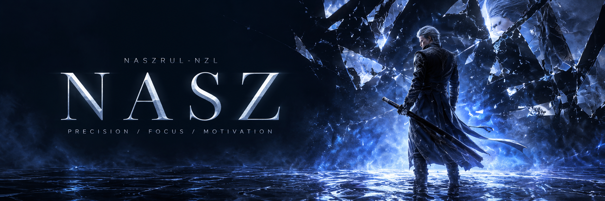

  <a href="#the-dossier">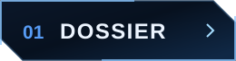</a>
  <a href="#selected-work">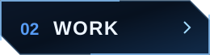</a>
  <a href="#the-arsenal">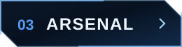</a>
  <a href="#find-me">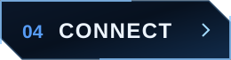</a>

<picture>
  <source media="(max-width: 600px)" srcset="assets/section-dossier-mobile.svg" />
  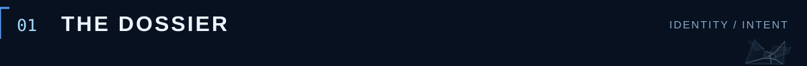
</picture>

<picture>
  <source media="(max-width: 600px)" srcset="assets/dossier-mobile.svg" />
  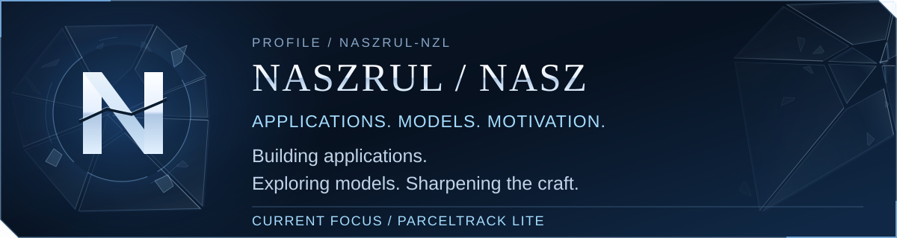
</picture>

  My projects bring together <b>application development</b>, <b>programming coursework</b>, and <b>mathematical modelling</b>. 
  Building thoughtfully. Learning continuously.

<picture>
  <source media="(max-width: 600px)" srcset="assets/section-work-mobile.svg" />
  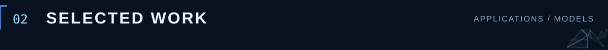
</picture>

<a href="https://github.com/Naszrul-NZL/ParcelTrack-Lite" aria-label="PARCELTRACK LITE repository">
<picture>
  <source media="(max-width: 600px)" srcset="assets/project-parceltrack-mobile.svg" />
  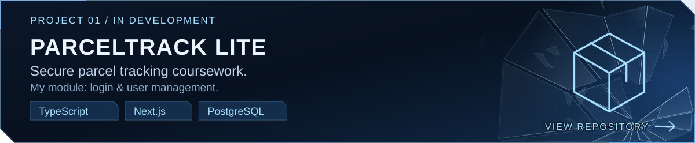
</picture>
</a>

<a href="https://github.com/Naszrul-NZL/TaskFlow" aria-label="TASKFLOW repository">
<picture>
  <source media="(max-width: 600px)" srcset="assets/project-taskflow-mobile.svg" />
  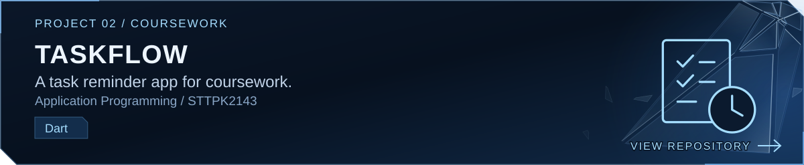
</picture>
</a>

<a href="https://github.com/Naszrul-NZL/Transport-Discrete-Choice-Model" aria-label="TRANSPORT CHOICE MODEL repository">
<picture>
  <source media="(max-width: 600px)" srcset="assets/project-transport-mobile.svg" />
  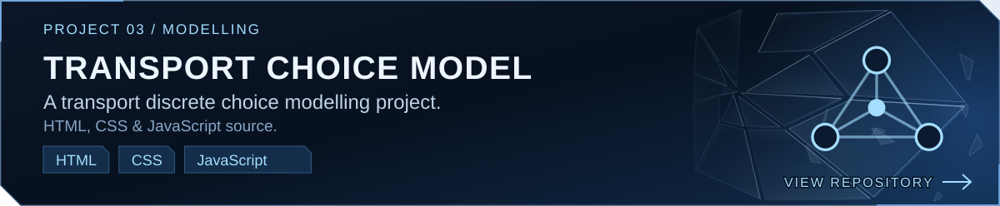
</picture>
</a>

  <a href="https://github.com/Naszrul-NZL?tab=repositories"><b>Explore all repositories ↗</b></a>

<picture>
  <source media="(max-width: 600px)" srcset="assets/section-toolkit-mobile.svg" />
  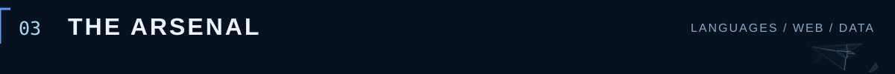
</picture>

<picture>
  <source media="(max-width: 600px)" srcset="assets/toolkit-languages-mobile.svg" />
  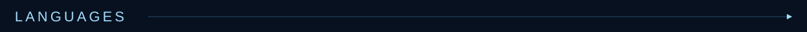
</picture>

  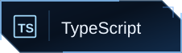
  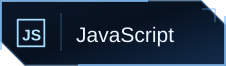
  
  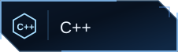
  

<picture>
  <source media="(max-width: 600px)" srcset="assets/toolkit-web-mobile.svg" />
  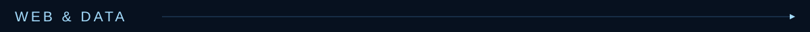
</picture>

  
  
  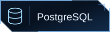
  
  

Tools found in my projects. Always room to learn more.

<picture>
  <source media="(max-width: 600px)" srcset="assets/section-connect-mobile.svg" />
  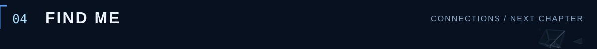
</picture>

  <a href="https://github.com/Naszrul-NZL?tab=repositories">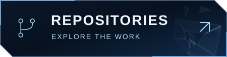</a>
  <a href="https://www.linkedin.com/in/muhammad-naszrul/">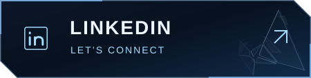</a>

<picture>
  <source media="(max-width: 600px)" srcset="assets/footer-mobile.svg" />
  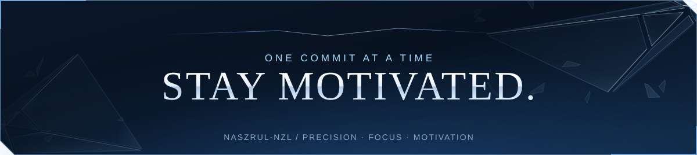
</picture>

Profile and projects in plain text

I'm Naszrul (NASZ). My public projects include application development, programming coursework, and mathematical modelling.

- **[ParcelTrack Lite](https://github.com/Naszrul-NZL/ParcelTrack-Lite):** secure parcel tracking coursework, currently in development. My assigned module covers login and user management. TypeScript, Next.js, PostgreSQL.
- **[TaskFlow](https://github.com/Naszrul-NZL/TaskFlow):** a task reminder app for STTPK2143 Application Programming coursework. Dart.
- **[Transport Discrete Choice Model](https://github.com/Naszrul-NZL/Transport-Discrete-Choice-Model):** a transport choice modelling project with HTML, CSS, and JavaScript source.

**Languages:** TypeScript, JavaScript, Dart, C++, MATLAB. **Web and data:** Next.js, React, PostgreSQL, HTML, CSS.

[GitHub repositories](https://github.com/Naszrul-NZL?tab=repositories) · [LinkedIn](https://www.linkedin.com/in/muhammad-naszrul/)

